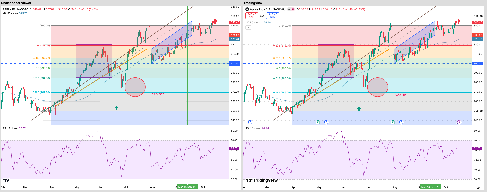

# ChartKeeper

ChartKeeper keeps your own copy of your TradingView charts. It saves every
chart layout, with all drawings, indicators and settings, as files on your
computer. You can look at your charts without internet, and you can put a
chart back on TradingView from any backup.

ChartKeeper is not made by TradingView. It uses the same requests as the
TradingView website. It only reads your charts when it takes a backup, and it
only changes something on TradingView when you ask it to restore a chart.

## 1. Install

Download the file for your computer from the
[releases page](https://github.com/MarkLyck/chartkeeper/releases):

| Computer | File |
| --- | --- |
| Windows | `ChartKeeper-1.0.0-win-x64.exe` |
| Mac | `ChartKeeper-1.0.0-mac-universal.dmg` |
| Linux | `ChartKeeper-1.0.0-linux-x86_64.AppImage` or `.deb` |

**Windows.** Double-click the `.exe` file. If Windows shows "Windows protected
your PC", click **More info**, then **Run anyway**. Follow the steps and click
**Finish**. ChartKeeper is now on your desktop and in the Start menu.

**Mac.** Double-click the `.dmg` file and drag **ChartKeeper** to the
**Applications** folder. The first time you open it, the Mac says it can't
check ChartKeeper for malware. Click **Done**. Then open **System Settings**,
choose **Privacy & Security**, scroll down to the message about ChartKeeper,
and click **Open Anyway**. Type your Mac password and click **Open**. After that
you can open it normally. After you install a new version, your
Mac may ask whether ChartKeeper may use "ChartKeeper Safe Storage". Type your
Mac password and click **Always Allow**. That is where ChartKeeper keeps your
TradingView sign-in locked.

**Linux.** Right-click the `.AppImage` file, choose **Properties**, tick
**Allow executing file as program**, then double-click it. Or install the
`.deb` file with your software center.

Windows and Mac show these warnings because ChartKeeper is not signed with a
paid developer certificate. The warnings only appear the first time.

## 2. Sign in to TradingView


1. Open ChartKeeper and click **Sign in to TradingView**.
2. A Chrome window opens on the TradingView sign-in page. Sign in the way you
   always do: with Google, email, or another option. Two-step codes work.
3. When you are signed in, the window closes by itself and ChartKeeper shows
   "Signed in to TradingView as ...".

ChartKeeper never sees or saves your password. It keeps only the "you are
signed in" cookie, in a private folder on your computer, and it only ever
talks to tradingview.com.

## 3. Take a backup


Click **Back up now**. A backup takes a few minutes, because ChartKeeper asks
TradingView for one thing at a time so your account isn't flagged. When it is
done you see a green check and how many layouts were saved.

The backups go into the folder shown under **Settings**. Click **Change...**
to pick another folder, for example on an external disk or in Dropbox. Each
backup is a separate folder named by date and time, so older backups are never
overwritten.

**Daily backups.** Turn on **Back up automatically every day**. ChartKeeper
then starts with your computer, stays in the system tray (the icons near the
clock), and takes one backup a day after the hour you pick. If your computer
was off, it catches up the next time it's on.

## 4. Look at your charts offline


Click **View my backups**, pick a backup on the left, then pick a layout. You
can zoom with the mouse wheel and drag the chart to move it.

The box **Not shown** lists anything the viewer can't draw, for example labels
that a Pine script draws, and says why. These things are still in the backup.

**What changed?** Pick **Compare with an older backup** to see which drawings
and indicators were added, removed or moved between two backups.


## 5. Put a chart back on TradingView


1. Click **Restore a chart**.
2. Pick the backup and the layout.
3. Choose **As a new layout** (recommended). This adds a new layout called
   "<name> (restored <date>)" and doesn't change anything else.
   If your TradingView plan has no free layout slot, ChartKeeper tells you
   and explains your options.
4. Click **Restore**. ChartKeeper then opens the new layout itself and checks
   that all drawings and indicators came back. You see the result as a
   table.


**Replace one of my layouts.** You can also replace one of your existing layouts. To
do that, you must type the layout's name to confirm. ChartKeeper first saves
a safety copy of the layout it replaces, in the folder `safety-copies`.

**Templates.** **Restore my templates and themes** adds drawing templates,
indicator templates and colour themes from a backup that are missing in your
account. It never changes existing ones.

## What is not backed up

Alerts, watchlists, and other people's scripts are not backed up. The viewer
can't draw labels and boxes made by Pine scripts, or a few rare drawing tools.
[docs/LIMITATIONS.md](docs/LIMITATIONS.md) has the full list and the reasons.

## Your data and TradingView's rules

TradingView's terms allow market data for your own personal viewing.
ChartKeeper saves prices only so you can view your own charts offline. Keep
the backups to yourself. To save only layouts and drawings, switch off **Also
save prices so charts can be viewed offline** in the settings.

---

## For developers

- [docs/INVESTIGATION.md](docs/INVESTIGATION.md) records how tradingview.com
  stores layouts and the endpoints ChartKeeper uses.
- [docs/decisions.tsv](docs/decisions.tsv) is the decision log.
- `npm run viewer:compare` writes the viewer and TradingView's own rendering
  of the same layout side by side:
  
- `src/core/` holds the TradingView client, backup, restore, diff and snapshot
  format, with no Electron code. `src/core/tv/` is the only folder that knows
  TradingView URLs and response shapes.
- `src/main/` is the Electron app process (sign-in, private session, tray,
  daily schedule). `src/renderer/` is the window, and `src/renderer/viewer/`
  is the offline chart viewer (Lightweight Charts, Apache 2.0).

```sh
npm install
npm test                 # unit tests: parsing, restore logic, viewer, strings
npm run test:e2e         # starts the real app window
npm run viewer:compare   # viewer next to TradingView's own rendering
npm run test:live        # round trip on a real TradingView account (asks you to sign in)
npm run dist             # installer for this computer, in release/
npx tsx scripts/packaged-smoke.ts   # starts the packaged app from release/ and opens a backup
npx tsx scripts/record-demos.ts     # demo videos in docs/demos (needs an unlocked screen)
```

Set `CHARTKEEPER_BROWSER` to a browser's path to sign in with that browser, or
to `none` to use ChartKeeper's own sign-in window.

`npx tsx scripts/capture-reference.ts` rebuilds the reference backup and the
TradingView screenshot from a signed-out TradingView chart.
