# ChartKeeper

ChartKeeper keeps your own copy of your TradingView charts. It saves every
chart layout, with all drawings, indicators and settings, as files on your
computer. You can look at your charts without internet, and you can put a
chart back on TradingView from any backup.

ChartKeeper is not made by TradingView. It uses the same requests as the
TradingView website. It only reads your charts when it takes a backup. When
you restore a chart, it adds a new layout. ChartKeeper never changes or
deletes anything you already have on TradingView.

## 1. Install

Download the file for your computer from the
[releases page](https://github.com/MarkLyck/chartkeeper/releases):

| Computer | File |
| --- | --- |
| Windows | `ChartKeeper-1.0.0-win-x64.exe` |
| Mac | `ChartKeeper-1.0.0-mac-universal.dmg` |
| Linux | `ChartKeeper-1.0.0-linux-x86_64.AppImage` or `.deb` |

**Windows.** Double-click the `.exe` file. If Windows shows "Windows protected
your PC", click **More info**, then **Run anyway**. Follow the steps and click
**Finish**. ChartKeeper is now on your desktop and in the Start menu.

**Mac.** Double-click the `.dmg` file and drag **ChartKeeper** to the
**Applications** folder. The first time you open it, the Mac says it can't
check ChartKeeper for malware. Click **Done**. Then open **System Settings**,
choose **Privacy & Security**, scroll down to the message about ChartKeeper,
and click **Open Anyway**. Type your Mac password and click **Open**. After that
you can open it normally. After you install a new version, your
Mac may ask whether ChartKeeper may use "ChartKeeper Safe Storage". Type your
Mac password and click **Always Allow**. That is where ChartKeeper keeps your
TradingView sign-in locked.

**Linux.** Right-click the `.AppImage` file, choose **Properties**, tick
**Allow executing file as program**, then double-click it. Or install the
`.deb` file with your software center.

Windows and Mac show these warnings because ChartKeeper is not signed with a
paid developer certificate. The warnings only appear the first time.

## 2. Sign in to TradingView

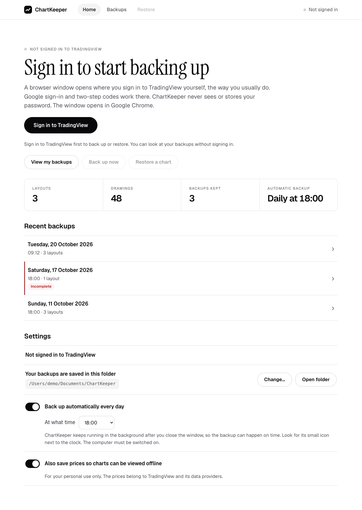

1. Open ChartKeeper and click **Sign in to TradingView**.
2. A Chrome window opens on the TradingView sign-in page. Sign in the way you
   always do: with Google, email, or another option. Two-step codes work.
3. When you are signed in, the window closes by itself and ChartKeeper shows
   "Signed in to TradingView as ...".

ChartKeeper uses your default browser when it is Chrome, Edge, Brave or a
similar browser. On Windows and Linux it otherwise uses another one of those
that is installed.

On a Mac whose default browser is Safari, Dia, Arc, Firefox or another browser
ChartKeeper can't open, it uses **Safari**:

- If you are already signed in to TradingView in Safari, ChartKeeper uses that
  sign-in, and nothing opens.
- Otherwise the TradingView sign-in page opens in Safari. Sign in there, and
  ChartKeeper notices a few seconds later.
- The first time, macOS has to allow ChartKeeper to read Safari's sign-in.
  ChartKeeper shows a message with an **Open System Settings** button. In
  **Privacy & Security > Full Disk Access**, turn on ChartKeeper. If it isn't in
  the list, click **+** and choose ChartKeeper in Applications. Click **Quit &
  Reopen** when macOS asks, then click **Sign in to TradingView** again.
- If you'd rather not allow that, choose **Use a ChartKeeper window instead**
  and sign in with your TradingView email and password.

Click **Cancel** under "Waiting for you to sign in..." to stop waiting.

ChartKeeper never sees or saves your password. It keeps only the "you are
signed in" cookie, in a private folder on your computer, and it only ever
talks to tradingview.com.

## 3. Take a backup

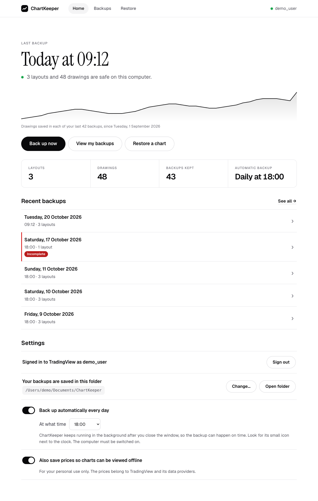

Click **Back up now**. A backup takes a few minutes, because ChartKeeper asks
TradingView for one thing at a time so your account isn't flagged. The window
shows how far it is and about how long is left. The longest step is the drawing
templates: TradingView has to be asked about each of its 89 drawing tools
separately.

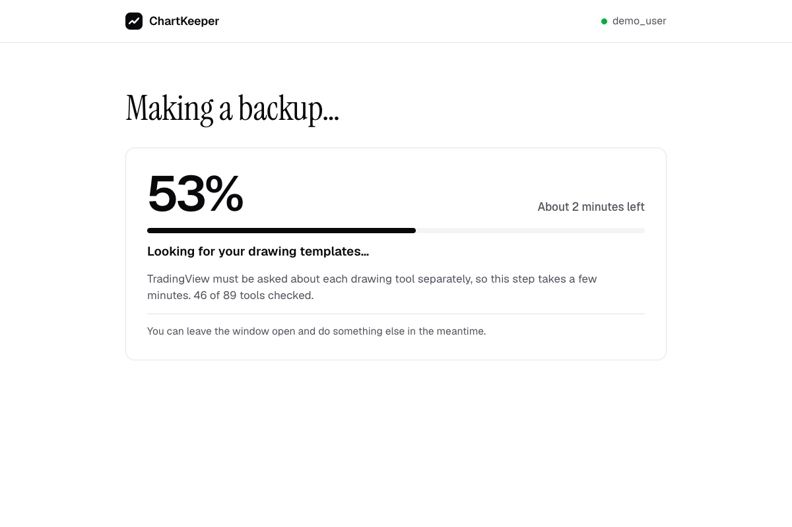

When it is done you see a green check and how many layouts were saved. The
home screen then shows when the last backup was taken, and once you have a
week of backups, a line of how many drawings each one holds.

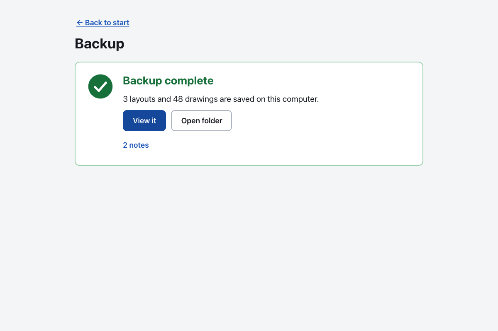

The backups go into the folder shown under **Settings**. Click **Change...**
to pick another folder, for example on an external disk or in Dropbox. Each
backup is a separate folder inside `snapshots`, named by date and time, so
older backups are never overwritten. Each backup folder has a `README.txt` that
lists your layouts by their TradingView names and says which folder holds each
one.

**Daily backups.** Turn on **Back up automatically every day**. ChartKeeper
then starts with your computer, stays in the system tray (the icons near the
clock), and takes one backup a day after the hour you pick. If your computer
was off, it catches up the next time it's on.

## 4. Look at your charts offline

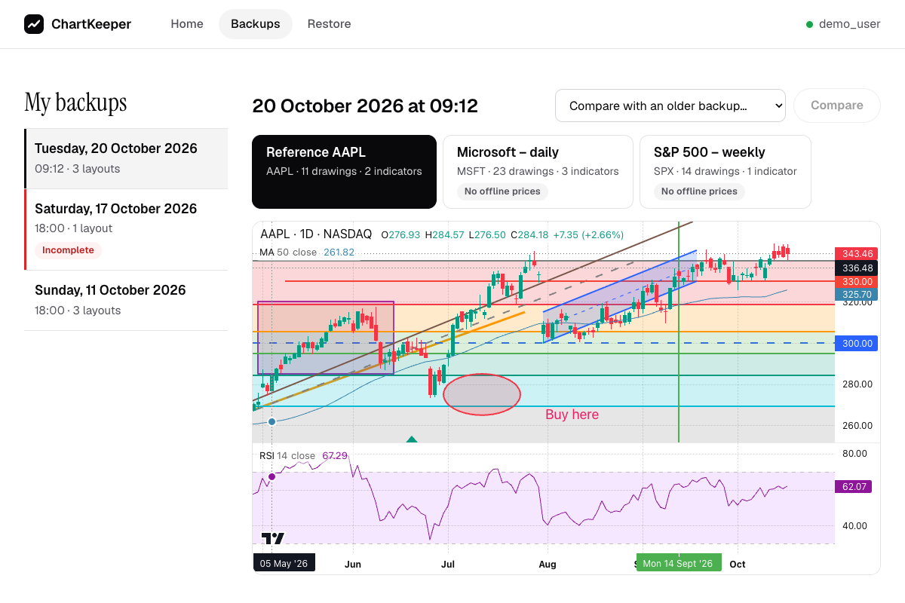

Click **View my backups**, pick a backup on the left, then pick a layout. You
can zoom with the mouse wheel and drag the chart to move it. A layout you never
gave a name in TradingView (TradingView calls it "Unnamed") is shown by its
symbols.

The box **Not shown** lists anything the viewer can't draw, for example labels
that a Pine script draws, and says why. These things are still in the backup.
Drawings you made on other symbols in the same layout take one line, with the
symbols that have the most drawings first. TradingView shows them when the
chart is switched to that symbol. When that line is all there is, the box
starts closed.

**What changed?** Pick **Compare with an older backup** to see which drawings
and indicators were added, removed or moved between two backups.

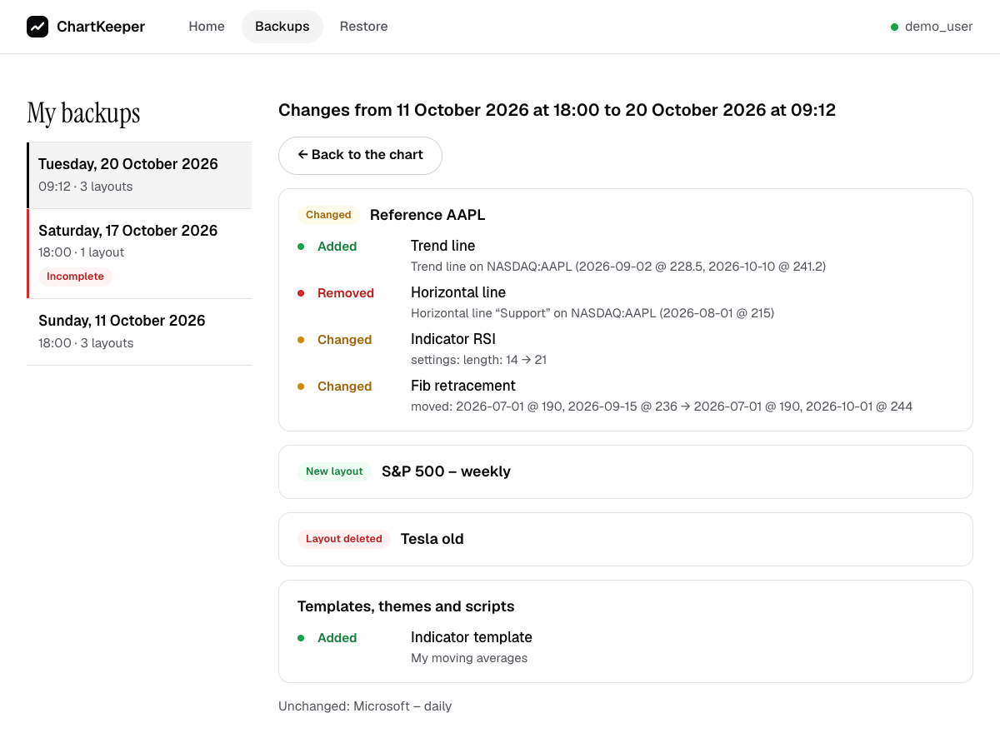

## 5. Put a chart back on TradingView

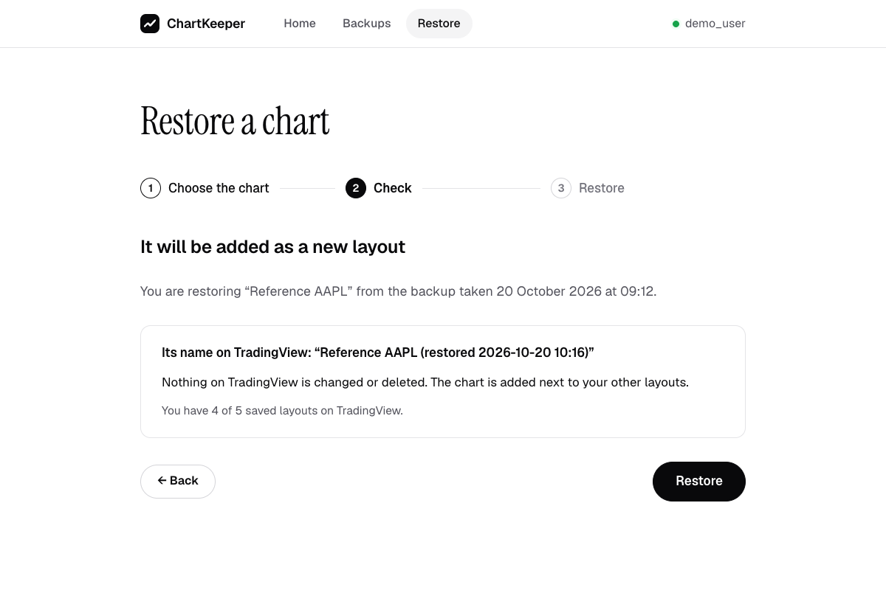

1. Click **Restore a chart**.
2. Pick the backup and the layout.
3. Check the name the new layout will get: "<name> (restored <date> <time>)".
   If your TradingView plan has no free layout slot, ChartKeeper tells you.
   Then delete a layout you no longer use on TradingView, or upgrade your
   plan, and try again.
4. Click **Restore**. ChartKeeper then opens the new layout itself and checks
   that all drawings and indicators came back. You see the result as a
   table.

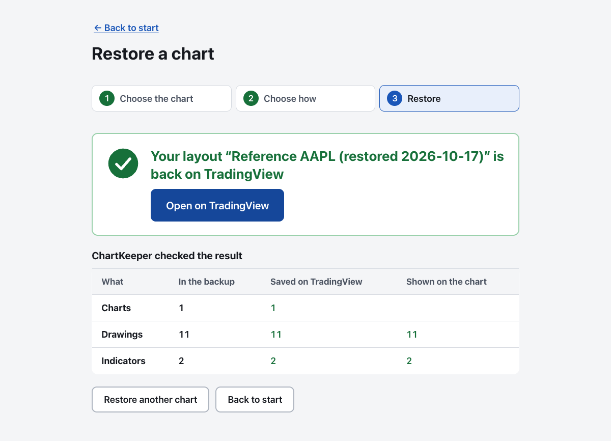

**Templates.** **Restore my templates and themes** adds drawing templates,
indicator templates and colour themes from a backup that are missing in your
account. If you already have one with the same name, even with other capital
letters, ChartKeeper leaves yours alone.

**Your charts on TradingView are safe.** ChartKeeper never changes or deletes
anything on TradingView:

- A restore always makes a new layout. It never saves over a layout you have.
- Templates and themes are only added under names you don't have yet.
- ChartKeeper checks every request before it goes to TradingView. Only four
  kinds of request may change anything there, and each one only adds
  something new. ChartKeeper lets one through only while it is sending that
  request itself. Any other request that would change something is stopped
  on your computer, including any that TradingView's own pages try, such as
  the page ChartKeeper opens to check a restored chart.

Earlier versions of ChartKeeper could replace a layout, and kept a copy of
the old layout in the folder `safety-copies`. You can still look at those
copies under **Backups**.

## What is not backed up

Alerts, watchlists, and other people's scripts are not backed up. The viewer
draws every drawing tool, chart style and built-in indicator, but not the
labels and boxes that Pine scripts draw, or image drawings.
[docs/LIMITATIONS.md](docs/LIMITATIONS.md) has the full list and the reasons.

## Your data and TradingView's rules

TradingView's terms allow market data for your own personal viewing.
ChartKeeper saves prices only so you can view your own charts offline. Keep
the backups to yourself. To save only layouts and drawings, switch off **Also
save prices so charts can be viewed offline** in the settings.

---

## For developers

- [docs/INVESTIGATION.md](docs/INVESTIGATION.md) records how tradingview.com
  stores layouts and the endpoints ChartKeeper uses.
- [docs/decisions.tsv](docs/decisions.tsv) is the decision log.
- `npm run gallery:compare` renders each of the 42 scenes in
  `test/fixtures/gallery` (every drawing tool, chart style and indicator a
  signed-out TradingView chart offers, captured from TradingView itself) with
  the viewer, scores every drawing, chart style and indicator against
  TradingView's pixels, and fails when a score drops below
  `test/gallery/thresholds.ts`. The report is in
  `.test-output/gallery-compare/index.html`. TradingView on the left,
  ChartKeeper on the right:
  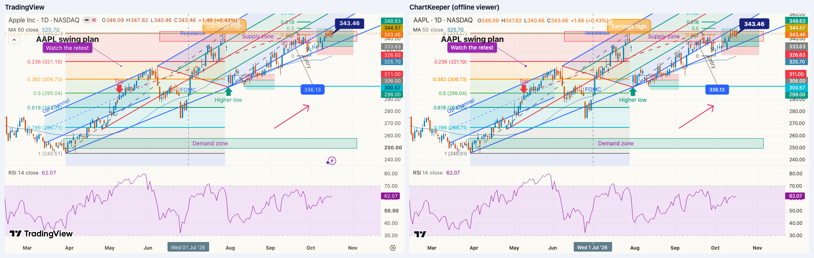
  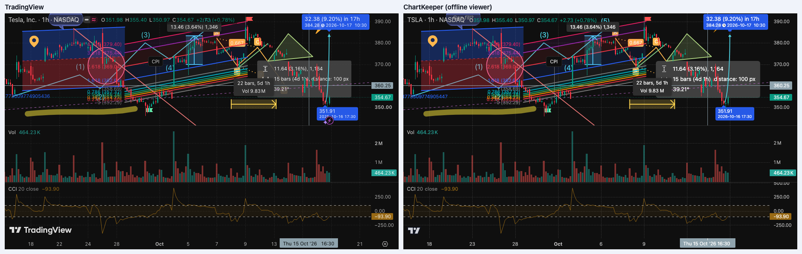
  The `replica-tsxv-weekly-log` scene copies a user's real chart: TSX Venture
  weekly on a log price scale, scrolled ten years into the future, with sine
  lines, time cycles, a fib time zone, Elliott waves in eight degrees and
  projections to 2043. `log-scale-tools` checks the tools whose shape depends
  on prices on a log scale. `npm run screenshots` regenerates these images.
  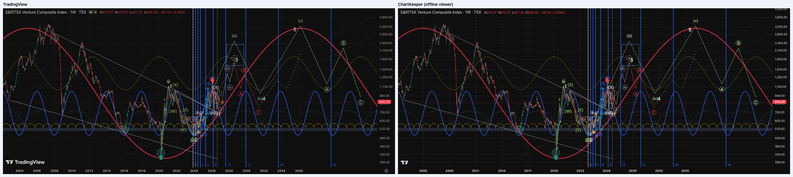
- `npm run viewer:compare` checks the cases the gallery can't capture (several
  charts in one layout, a chart without prices, unknown drawings, indicator
  errors) and writes `.test-output/viewer-gallery.png`.
- `src/core/` holds the TradingView client, backup, restore, diff and snapshot
  format, with no Electron code. `src/core/tv/` is the only folder that knows
  TradingView URLs and response shapes.
- `src/core/tv/writePolicy.ts` lists the only writes ChartKeeper may send, and
  each one creates something new. `PoliteHttp` refuses every other write
  before it reaches the page. The private session lets a write out only when
  it is one of those four and ChartKeeper's hidden page registered it right
  before sending it (`expectWrite` in `src/main/tvSession.ts`), once. Every
  other write is cancelled, so TradingView's own code in any page can't send
  one.
  `test/core/neverChangesTradingView.test.ts` backs up and restores a fake
  account and checks that nothing that existed changed.
- `src/main/` is the Electron app process (sign-in, private session, tray,
  daily schedule). `src/renderer/` is the window, and `src/renderer/viewer/`
  is the offline chart viewer (Lightweight Charts, Apache 2.0). It draws
  icon drawings with the Font Awesome 4.7 font (SIL OFL 1.1,
  [licenses/font-awesome-OFL.txt](licenses/font-awesome-OFL.txt)).

```sh
npm install
npm test                 # unit tests: parsing, restore logic, viewer, strings
npm run test:e2e         # starts the real app window and runs every flow against a fake TradingView
npm run gallery:compare  # every tool, style and indicator against TradingView's own rendering
npm run viewer:compare   # multi-chart layouts and error cases in the viewer
npm run test:compat      # restore keeps every feature, checked by tradingview.com's own loader (no account)
npm run test:live        # round trip on a real TradingView account (asks you to sign in)
npm run dist             # installer for this computer, in release/
npx tsx scripts/packaged-smoke.ts   # starts the packaged app from release/ and opens a backup
npx tsx scripts/record-demos.ts     # demo videos in docs/demos (needs an unlocked screen)
```

The end-to-end tests need no TradingView account. `npm run test:e2e` also
builds `dist-test/fake-tradingview.js`, and the app loads it when it runs
unpackaged with `CHARTKEEPER_FAKE_TRADINGVIEW=1`. The fake answers the
tradingview.com requests of the app's private session, so the hidden
TradingView page and the restore check run as shipped. A packaged app ignores
the variable, and the installer never contains `dist-test/`.

Set `CHARTKEEPER_BROWSER` to a browser's path to sign in with that browser, to
`safari` to sign in with Safari, or to `none` to use ChartKeeper's own sign-in
window.

`npx tsx scripts/capture-reference.ts` rebuilds the reference backup and the
TradingView screenshot from a signed-out TradingView chart.

### Compatibility test

`npm run test:compat` backs up an "advanced" test account (every drawing tool,
custom styles, indicators, custom chart settings, two charts, and the replica
of a user's log-scale weekly chart with its far-future drawings) with the real
backup code, and restores it with the real restore code. It then loads the
content that the restore sends to TradingView into a signed-out
tradingview.com chart, through TradingView's own loader. It reads the result
back with TradingView's own serializer and compares every drawing, indicator
and chart setting. The report is in `.test-output/compat/report.md`.
`test/compat/knownRewrites.ts` lists the values that TradingView's loader
changes by itself. `npx tsx scripts/build-compat-fixture.ts` rebuilds the
drawing-tool fixture from tradingview.com.

### Live round trip in CI

The `live` job in `.github/workflows/compat.yml` runs `npm run test:live` with
a saved TradingView session. When the session secret is not set, the job is
skipped. This happens on pull requests from forks, which get no secrets.

To set the secret:

1. Sign in once on your computer: `npm run test:live`. A browser window opens.
   Sign in to the test account. The session is saved to
   `.test-output/live-session.json`.
2. Store the session as a repository secret:
   `gh secret set TV_SESSION_COOKIES < .test-output/live-session.json`.
3. When TradingView ends the session, the job fails with "has expired". Delete
   `.test-output/live-session.json` and do steps 1 and 2 again.

The secret is a signed-in TradingView session. Anyone who can read it can use
that TradingView account, and a workflow change in a branch of this
repository can read it. Use a dedicated test account with no payment details
and no layouts you need. Each run creates one layout on that account and then
deletes it (`TV_TEST_CLEANUP=1`), so the account needs one free layout slot.
